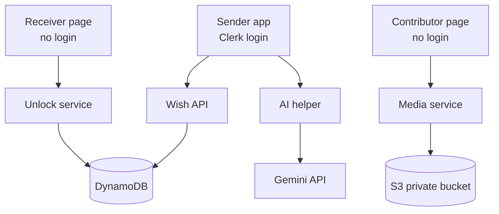

# Wishly: Architecture

Wishly is a web app where people create password-protected, interactive wish pages (birthday, anniversary, love, friendship, festival and more), alone or together with friends. The receiver opens a link, enters a password and sees an animated reveal.

Copy this file to `docs/ARCHITECTURE.md` in your project. Your coding agent should treat it as the source of truth.

---

## 1. Goals and principles

1. **Instant, not rendered.** The wish is shown live in the browser. There is no video rendering step.
2. **Private by default.** Nothing private (message, media) is returned before the correct password is entered.
3. **Works with no cloud keys.** Local development uses in-memory adapters. Production uses AWS and Clerk, switched by environment variables.
4. **Simple and boring.** One Next.js app, typed end to end, small repository interfaces.
5. **Mobile first.** Most receivers open the link from Instagram or WhatsApp.

---

## 2. System overview



### Layers

| Layer | Component | Responsibility |
|---|---|---|
| Client | Sender app | Dashboard, create wizard, replies inbox, Clerk login |
| Client | Receiver page | Lock screen, reveal animation, reply |
| Client | Contributor page | Add photo, video, voice note or message with no login |
| Server (Next.js route handlers) | Wish API | Owner-only create, read, update, delete (Clerk verified) |
| Server | Unlock service | Rate limit, hash check, signed cookie |
| Server | Media service | Presigned upload and download URLs, upload validation |
| Server | AI helper | Message ideas through the Gemini API |
| Data | DynamoDB | Wishes, contributions, replies, view counters |
| Data | S3 private bucket | Photos, videos, voice notes |
| External | Clerk | Sender identity |
| External | Gemini API | Message idea generation |

---

## 3. Tech stack

- Next.js 15 (App Router), TypeScript (strict), Tailwind CSS, Framer Motion
- Zod for validation, React Hook Form for forms
- Clerk for sender authentication
- AWS SDK v3: DynamoDB and S3
- Gemini API (server side only)
- Vitest (unit tests), Playwright (end-to-end tests)
- pnpm; deploy to Vercel or AWS Amplify

**Why Next.js:** server-rendered Open Graph tags give clean link previews in WhatsApp, Instagram and Telegram, and password checks stay on the server.

---

## 4. Repository pattern

All data access goes through interfaces, so the app runs with no cloud keys.

| Interface | Dev adapter | Production adapter |
|---|---|---|
| WishRepo | JSON file | DynamoDB |
| ContributionRepo | JSON file | DynamoDB |
| ReplyRepo | JSON file | DynamoDB |
| MediaStore | Local folder with fake signed URLs | S3 presigned URLs |
| AuthProvider | Dev bypass user (flag) | Clerk |

Select adapters with `DATA_ADAPTER=file|dynamodb` and `MEDIA_ADAPTER=file|s3`, and identity with
`AUTH_MODE=dev|clerk`. These are the names the code reads (`lib/env.ts`); the file adapter is the
default so the app runs with no cloud keys. `lib/repos/index.ts` branches on those values and is the
only place that constructs an adapter.

The local upload/serve routes (`/api/uploads/*`, `/api/media/*`) are gated to `MEDIA_ADAPTER=file`;
with S3 the browser uploads and reads straight from presigned URLs.

---

## 5. Key flows

### 5.1 Create and publish a wish
1. The sender signs in with Clerk.
2. The wizard saves a draft after each step.
3. Photos and videos upload straight from the browser to S3 using presigned PUT URLs.
4. On publish, the server hashes the password (argon2id), stores only the hash, and sets status to Published.
5. The sender gets a link like `/w/abc123`, the password, a QR code and share buttons.

### 5.2 Unlock and reveal
1. The receiver opens `/w/abc123`.
2. The server returns only: receiver name, hint, template id, lock state (and unlock date if set).
3. The receiver submits a password to `POST /api/wishes/:id/unlock`.
4. The server rate-limits the request, compares against the hash in constant time, and on success sets a short-lived signed httpOnly cookie scoped to that wish.
5. The page then loads the message and gets short-lived presigned S3 download URLs for the media.
6. The receiver can send a reply (text and emoji reaction).

### 5.3 Group wish (memory wall)
1. The sender creates a wish in group mode and gets a contributor link with an unguessable token.
2. Contributors add a photo, video, voice note or message (name only). Items start as `pending`.
3. The sender approves, hides and reorders items.
4. On publish, approved items appear as a memory wall in the reveal.
5. The sender can revoke the contributor link at any time.

---

## 6. API design

| Method | Path | Auth | Purpose |
|---|---|---|---|
| POST | /api/wishes | Sender | Create draft |
| GET | /api/wishes | Sender | List own wishes |
| PATCH | /api/wishes/:id | Sender | Update draft or published wish |
| DELETE | /api/wishes/:id | Sender | Delete wish and media |
| GET | /api/wishes/:id/contributions | Sender | List contributions for moderation |
| PATCH | /api/wishes/:id/contributions | Sender | Reorder contributions |
| PATCH | /api/wishes/:id/contributions/:contributionId | Sender | Approve, hide, or restore |
| DELETE | /api/wishes/:id/contributions/:contributionId | Sender | Remove a contribution and its media |
| POST | /api/wishes/:id/password | Sender | Hash and store the password |
| POST | /api/wishes/:id/publish | Sender | Publish (bumps `passwordVersion`) |
| POST | /api/wishes/:id/duplicate | Sender | Duplicate as a fresh draft |
| POST | /api/wishes/:id/contributor-link | Sender | Mint or rotate the contributor link |
| DELETE | /api/wishes/:id/contributor-link | Sender | Revoke the contributor link |
| GET | /api/w/:id/meta | None | Lock screen data only (strict projection) |
| POST | /api/w/:id/unlock | None, rate limited | Verify password, set cookie |
| GET | /api/w/:id/content | Unlock cookie | Message, media URLs, approved contributions |
| POST | /api/w/:id/reply | Unlock cookie | Receiver reply |
| POST | /api/w/:id/view | None | Aggregate view counter |
| POST | /api/c/:token/upload/presign | Contributor token | Presigned upload URL |
| POST | /api/c/:token/contribute | Contributor token | Add a pending contribution |
| POST | /api/upload/presign | Sender | Presigned upload URL |
| POST | /api/ai/ideas | Sender | Generate message ideas |

All inputs are validated with Zod. Errors are generic on the unlock route.

---

## 7. Data model (DynamoDB)

**Wishes**
`wishId` (PK), `ownerId`, `mode` (solo|group), `category`, `templateId`, `receiverName`, `title`, `message`, `mediaKeys[]`, `musicId`, `passwordHash`, `passwordHint`, `unlockAt`, `status` (draft|collecting|published|locked), `contributorToken`, `views`, `createdAt`, `updatedAt`
GSI: `ownerId` + `createdAt` (dashboard list)

**Contributions**
`wishId` (PK), `contributionId` (SK), `contributorName`, `type` (photo|video|voice|text), `mediaKey`, `text`, `status` (pending|approved|hidden), `order`, `createdAt`

**Replies**
`wishId` (PK), `replyId` (SK), `message`, `emoji`, `createdAt`

**Views**
Aggregated counter on the wish item only. No personal data.

**S3 key layout**
`wishes/{wishId}/{kind}/{random-id}.{ext}` in a private bucket (block public access ON), where
`kind` is `photo | video | voice`. The kind segment is what lets rendering code derive the media
type from the key alone.

---

## 8. Security model

| Area | Rule |
|---|---|
| Passwords | argon2id (or bcrypt cost 12). Never stored or logged in plain text. |
| Verification | Server side only. Constant-time compare. Generic error message. |
| Pre-unlock data | Only receiver name, hint, template id, lock state. No message, no media URLs. |
| After unlock | Short-lived signed httpOnly cookie scoped to one wish. |
| Media | Private S3 bucket. Short-lived presigned GET URLs after unlock only. |
| Rate limiting | Per IP and per wish: 5 attempts, then cooldown. |
| Uploads | Validate type and size (images 10 MB, video 100 MB or 60 s, voice 5 MB). Presigned PUT with fixed content type and random keys. |
| Sender endpoints | Verify the Clerk session and ownership on every call. |
| Contributor links | Unguessable tokens, revocable. |
| SEO and previews | Wish pages are noindex, nofollow. Open Graph shows a generic teaser only. |
| Abuse and privacy | Report-abuse link, delete-my-data option, privacy and terms pages. |
| Secrets | Environment variables only. Never commit `.env`. |

---

## 9. Frontend structure

```
app/
  (marketing)/            landing, occasions, templates, pricing, privacy, terms, report
  (auth)/sign-in/         Clerk sign-in (dev bypass explains itself)
  (app)/dashboard/        wish list, replies inbox, edit wizard, collect moderation, QR card
  w/[id]/                 receiver lock + reveal
  c/[token]/              contributor page (no login)
  api/                    route handlers (section 6)
components/
  ui/ marketing/ wizard/ reveal/ receiver/ contributor/ dashboard/
lib/
  repos/                  interfaces + file adapter (+ dynamodb/s3 adapters)
  auth/                   dev bypass + clerk adapters
  security/               hash, rate limit, unlock token, media token, contributor token
  ai/                     gemini client + curated fallback
  catalog/                occasions, templates, music
  validation/             shared Zod schemas
app/globals.css           design tokens
docs/
  ARCHITECTURE.md
  DATA_MODEL.md
DESIGN.md
CLAUDE.md                 agent conventions and commands
```

---

## 10. Design system (summary)

Warm like Airbnb, immersive like Spotify, calm and premium like Oura. Style inspiration only: no logos, names or proprietary fonts.

- Sender area is light and photo-first. The receiver reveal and dark mode are dark and immersive.
- Coral `#FF385C` is the only primary action color. Gold `#D6C283` is reserved for surprise moments (unlock ring, reveal glow).
- Instrument Serif italic for emotional titles, Inter for UI.
- Pill buttons, 24px cards, 16px media tiles, 8px spacing unit.
- Dark mode depth comes from surface steps (`#121212`, `#181818`, `#1F1F1F`, `#282828`), not heavy shadows.
- Respect `prefers-reduced-motion`. WCAG AA contrast.

Full tokens live in `DESIGN.md`.

---

## 11. Environment variables

```
DATA_ADAPTER=file                # file | dynamodb
MEDIA_ADAPTER=file               # file | s3
AUTH_MODE=dev                    # dev | clerk
WISHLY_DEV_AUTH_BYPASS=true      # dev only

NEXT_PUBLIC_CLERK_PUBLISHABLE_KEY=
CLERK_SECRET_KEY=

AWS_REGION=
AWS_ENDPOINT_URL=                # optional; set to LocalStack for local AWS
AWS_ACCESS_KEY_ID=
AWS_SECRET_ACCESS_KEY=
DYNAMODB_TABLE=
S3_BUCKET=

GEMINI_API_KEY=
GEMINI_MODEL=gemini-2.0-flash
AUTH_SECRET=                     # min 16 chars; signs dev media URLs and rate-limit keys
WISH_UNLOCK_SECRET=              # min 16 chars; signs unlock cookies
NEXT_PUBLIC_APP_URL=
FEATURE_BILLING=false
FEATURE_GROUP_MODE=false
```

Never paste real keys into chat or commit them.

---

## 12. Deployment

- **Hosting:** Vercel or AWS Amplify for the Next.js app.
- **AWS resources:** DynamoDB tables, one private S3 bucket (CORS allowing PUT from the app domain), an IAM user or role with least privilege.
- **CDN:** optional CloudFront in front of S3 later.
- **Monitoring:** error tracking and basic uptime checks.
- **Performance budget:** LCP under 2.5 s on a mid-range phone.

---

## 13. Milestones

| ID | Scope |
|---|---|
| M0 | Scaffold, tokens, layout shell, mock adapters, dev auth |
| M1 | Marketing pages, occasion pages, template gallery, SEO |
| M2 | Clerk auth, dashboard with seeded data |
| M3 | Create wizard (solo), drafts, AI ideas, mock uploads |
| M4 | Publish, unlock, reveal, replies, end-to-end test |
| M5 | AWS adapters and security hardening |
| M6 | Group mode (contributor link, moderation, memory wall) |
| M7 | QR card, music library, PWA, i18n scaffolding |
| M8 | Accessibility, performance, monitoring, deploy guide |

---

## 14. Reference: VidDay (inferred, not official)

VidDay does not publish its internals. This is a reconstruction from its website and a third-party tech listing that may be out of date.

| Layer | Likely component |
|---|---|
| Clients | Marketing site (Next.js), web app on a separate subdomain (React), Android TWA, iOS app |
| Backend | Application API for auth, events, invites, contributions, editor |
| Media | S3 uploads, render workers that build a 1080p MP4, CloudFront CDN |
| External | Stripe, Mandrill, gifting and tree-planting partners, Google Analytics |

| | VidDay | Wishly |
|---|---|---|
| Output | Rendered MP4 video | Live interactive page |
| Slow or costly step | Render workers | None (browser renders) |
| Access control | Private link | Link plus server-checked password |
| Data layer | Likely relational | DynamoDB with repository adapters |
| Main risk | Render queue and compute cost | Unlock abuse and media privacy |
